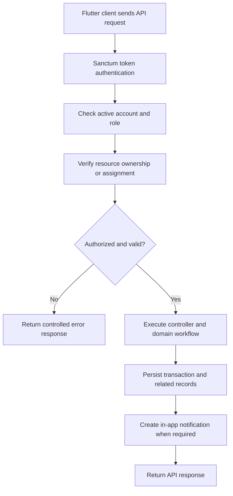

# NEXORA BACKEND

**REST API for internship logbook management and academic supervision.**

Laravel 12 · PHP 8.2+ · Sanctum · MySQL / SQLite

[Mobile client](https://github.com/gusti111/NEXORA-Mobile)

---

## Overview

NEXORA is a role-based platform for managing internship placements (Praktik Kerja Lapangan / PKL), daily activity logbooks, academic reviews, and progress reporting. This repository contains the Laravel API consumed by the Flutter mobile application.

The backend separates authentication, role checks, assignment ownership, logbook workflow rules, file access, notifications, and report generation.

## Roles and capabilities

| Role | Responsibilities |
| --- | --- |
| **Student (Mahasiswa)** | View their own placement, submit activity logbooks, attach photos and optional GPS coordinates, track review status, resubmit requested revisions, and view review history. |
| **Lecturer (Dosen)** | View assigned students and logbooks, approve or reject submissions, request revisions with comments, and inspect review history. |
| **Coordinator (Korlap)** | Monitor assigned students, view progress, complete eligible placements, and export PDF / Excel reports. |
| **Administrator** | Manage accounts and placements, inspect logbooks, reset passwords, and view platform statistics. |

## Architecture

    NEXORA Mobile (Flutter)
            │
            │ HTTPS + Bearer token
            ▼
    Laravel REST API
       ├── Sanctum authentication
       ├── Role and active-account middleware
       ├── Assignment ownership checks
       ├── Logbook submission and review workflow
       ├── Private photo delivery
       ├── Database notifications
       └── PDF / Excel exports
            │
            ▼
       MySQL or SQLite

## API request and authorization flow

## Technology

- PHP 8.2+
- Laravel 12
- Laravel Sanctum 4
- Eloquent ORM and database migrations
- MySQL or SQLite
- Intervention Image
- Laravel Excel
- DomPDF
- PHPUnit / Laravel testing tools

## Requirements

- PHP 8.2 or newer.
- Composer 2.
- Required PHP extensions, including PDO, database driver support, GD, fileinfo, mbstring, XML, and ZIP.
- Node.js and npm only when building the bundled Vite assets.
- MySQL or SQLite.

## Local setup

    git clone https://github.com/gusti111/NEXORA-Backend.git
    cd NEXORA-Backend

    composer install
    cp .env.example .env
    php artisan key:generate

The example environment is configured for SQLite by default. Create the database file if it does not exist:

    # macOS / Linux
    touch database/database.sqlite

For Windows PowerShell:

    New-Item -ItemType File -Force database/database.sqlite

For MySQL, configure the DB_CONNECTION, DB_HOST, DB_PORT, DB_DATABASE, DB_USERNAME, and DB_PASSWORD values in .env.

Run database migrations:

    php artisan migrate

Create the public storage link:

    php artisan storage:link

Start the development server:

    php artisan serve --host=0.0.0.0 --port=8000

The API is available under /api and the Laravel health endpoint is /up. For an Android emulator, the typical local API base URL is http://10.0.2.2:8000/api.

Use HTTPS and production-grade database credentials outside local development. Never commit .env or production secrets.

## Authentication

The API uses Laravel Sanctum personal access tokens.

| Method | Endpoint | Purpose |
| --- | --- | --- |
| POST | /api/login | Authenticate with email or username and password. |
| POST | /api/register | Register a student account. |
| POST | /api/logout | Revoke the current access token. |
| GET | /api/user | Validate the current session and return the authenticated profile. |

Send the bearer token with protected requests:

    Accept: application/json
    Authorization: Bearer <access-token>

Protected routes combine authentication middleware, role checks, active-account validation, and resource ownership checks. Controllers scope data access to the authenticated user's own records or assigned students; role middleware alone is not treated as ownership authorization.

## Core workflows

- **Logbook submission:** a student can submit an entry only for their own active PKL placement and within the permitted activity date range.
- **Review:** the assigned lecturer can approve, reject, or request a revision. Revision requests require a comment.
- **Resubmission:** a student can resubmit only an entry marked for revision, and the current submission must contain an actual content or photo change.
- **Review history:** lecturer decisions are recorded in a dedicated review-history table.
- **Placement completion:** a coordinator can complete a placement after the required approved logbook condition is met.
- **Reports:** coordinator exports are available as PDF and Excel outputs.

## Idempotency and notifications

Mobile submissions can include an idempotency_key UUID. The backend stores it under a unique database constraint so retries do not create duplicate logbooks. Replays of the same key for the same placement return the existing record; reuse of a key for another placement is rejected.

Logbook creation and related database notifications are handled transactionally. Notification endpoints provide inbox retrieval, unread counts, and mark-read operations scoped to the authenticated user.

Notifications in this phase are database-backed in-app notifications. Firebase Cloud Messaging / Apple Push Notification delivery is not configured by this repository's current phase.

## File and privacy handling

Logbook photos are validated as image uploads, converted to JPEG, and processed to a bounded target size. New evidence files are stored on Laravel's non-public local disk. The authenticated photo endpoint checks the caller's relationship to the placement before streaming the file and uses private cache headers.

Latitude and longitude are optional and validated against geographic ranges.

## Verification

Run the backend test suite:

    php artisan test

The repository includes feature tests for authorization, photo access, notifications, end-to-end workflows, and mass-assignment constraints. CI configuration is maintained in .github/workflows/laravel-ci.yml.

A passing local test suite does not prove a production server, database, queue, or mail configuration is deployed correctly.

## Related resources

- [NEXORA Mobile](https://github.com/gusti111/NEXORA-Mobile)
- [Laravel documentation](https://laravel.com/docs)
- [Sanctum documentation](https://laravel.com/docs/sanctum)

## Project status

An academic team project with a substantial API foundation and automated test coverage. A production staging host has not been established in the repository; validate mobile/backend integration against a dedicated staging environment before a release.

## Author

**Gusty Faqikh** · [GitHub](https://github.com/gusti111)